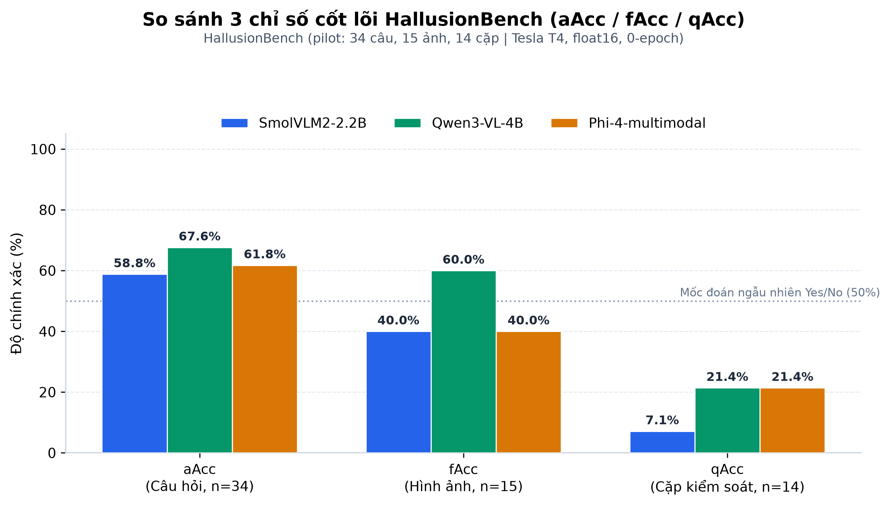
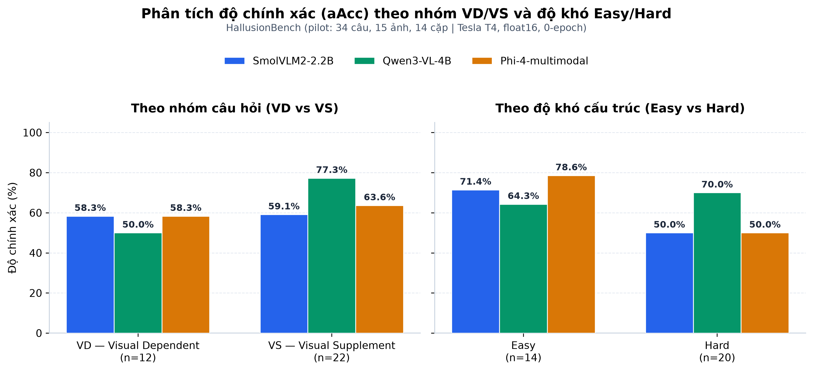
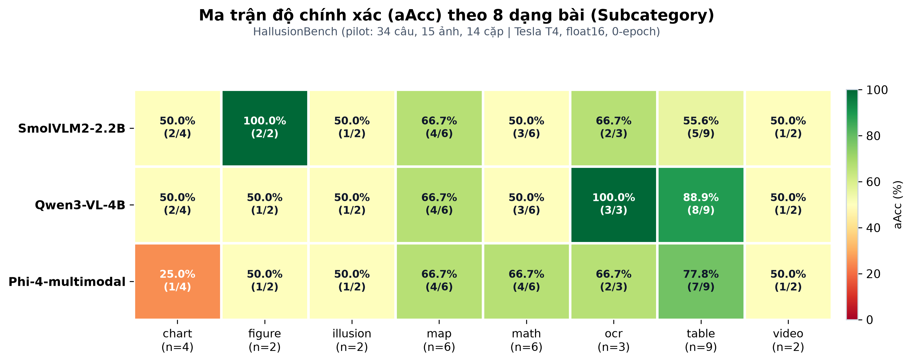
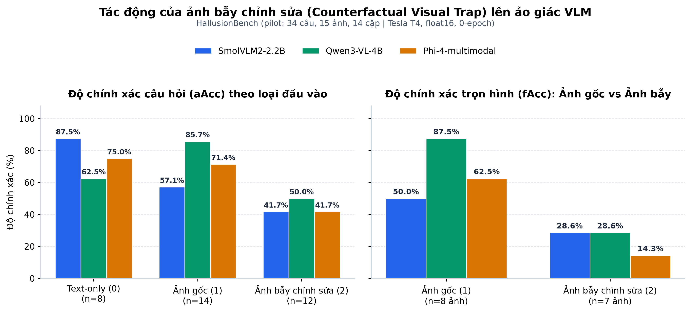
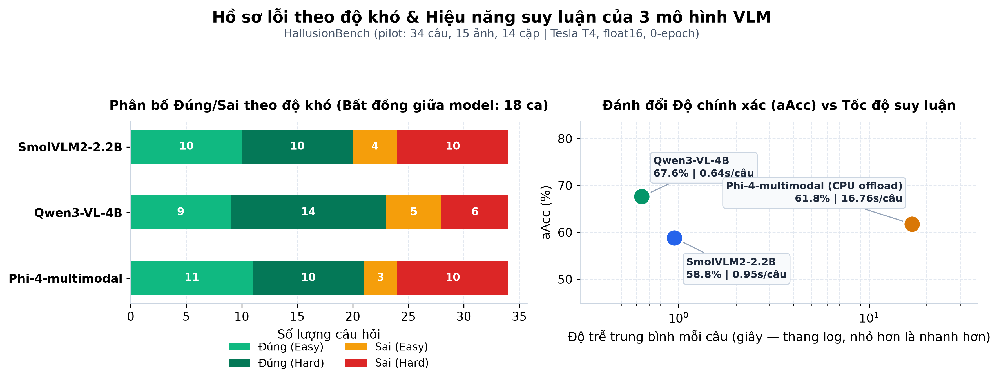

# Báo cáo Trực quan Đánh giá Ảo giác VLM trên HallusionBench (Nhóm 2)

> **Phạm vi thực nghiệm:** `pilot` — **34 câu hỏi** (15 hình ảnh thật, 14 cặp kiểm soát phủ đủ **8/8 dạng bài**: `chart`, `figure`, `illusion`, `map`, `math`, `ocr`, `table`, `video`), **0 epoch (zero-shot)**, thiết bị `Tesla T4`, `float16`, **0 lỗi kỹ thuật / 0 lỗi định dạng**.

---

## 1. Bảng tổng hợp hiệu năng 3 mô hình

| Mô hình | Model Revision | Thiết bị / Dtype | Avg Latency | Hoàn thành | aAcc | fAcc | qAcc | VD (aAcc) | VS (aAcc) | Easy / Hard (aAcc) |
|---|---|---|---:|---:|---:|---:|---:|---:|---:|---|
| **SmolVLM2-2.2B** (`smolvlm2`) | `be92141c8d` | `Tesla T4` / `float16` | 0.95s | 34/34 | **58.82%** | **40.00%** | **7.14%** | 58.33% | 59.09% | 71.43% / 50.00% |
| **Qwen3-VL-4B** (`qwen3_vl`) | `ebb281ec70` | `Tesla T4` / `float16` | 0.64s | 34/34 | **67.65%** | **60.00%** | **21.43%** | 50.00% | 77.27% | 64.29% / 70.00% |
| **Phi-4-multimodal** (`phi4_multimodal`) | `93f923e1a7` | `Tesla T4` / `float16` + offload | 16.76s | 34/34 | **61.76%** | **40.00%** | **21.43%** | 58.33% | 63.64% | 78.57% / 50.00% |

---

## 2. Biểu đồ trực quan phân tích kết quả

### 2.1. Tổng quan 3 chỉ số cốt lõi (`aAcc` / `fAcc` / `qAcc`)


- **Nhận xét chính:** Dù độ chính xác từng câu (`aAcc`) của 3 mô hình đạt **58.82% – 67.65%**, độ chính xác theo **cặp kiểm soát (`qAcc`) sụt giảm rất sâu xuống chỉ còn 7.14% – 21.43%**. Điều này cho thấy các VLM thường trả lời đúng một biến thể nhưng thất bại khi ảnh bị chỉnh sửa hoặc đổi điều kiện đối chứng — biểu hiện điển hình của **ảo giác dựa trên thiên kiến ngôn ngữ (language prior)**.

### 2.2. So sánh nhóm phụ thuộc hình ảnh (`VD` vs `VS`) và độ khó (`Easy` vs `Hard`)


- **Nhận xét chính:** `Qwen3-VL-4B` mạnh vượt trội ở nhóm **VS (Visual Supplement)** nhưng chỉ đạt mức đoán ngẫu nhiên (`50.0%`) ở nhóm **VD (Visual Dependent)**. Ngược lại, `Phi-4-multimodal` đạt độ chính xác cao nhất ở nhóm **Easy** nhưng sụt mạnh ở nhóm **Hard**.

### 2.3. Ma trận hiệu năng trên 8 dạng bài (`Subcategory`)


### 2.4. Tác động của ảnh bẫy chỉnh sửa (`visual_input`: Text-only vs Ảnh gốc vs Ảnh bẫy)


- **Bằng chứng trực tiếp về ảo giác thị giác:** Khi chuyển từ **ảnh gốc (`visual_input=1`)** sang **ảnh đã chỉnh sửa làm bẫy (`visual_input=2`)**, cả 3 mô hình đều giảm mạnh đồng thời ở cả `aAcc` lẫn `fAcc`.

### 2.5. Hồ sơ lỗi theo độ khó & Đánh đổi Độ chính xác vs Tốc độ


- **Đồng thuận & bất đồng giữa 3 mô hình:** Cả 3 mô hình cùng trả lời đúng **13/34** câu, cùng sai **3/34** câu, và có **18 ca bất đồng** (xem chi tiết tại [`cross_model_disagreements.json`](cross_model_disagreements.json)).

---

## 3. Khả năng tái lập & kiểm chứng artifact

Tất cả 3 run đều có đủ 7 artifact chuẩn (`docs/result_schema.md`) cùng gói JSON/log dễ đọc và đã vượt qua `scripts/check_results.py` & `scripts/check_manifest.py`:

```bash
python -m benchmarks.hallusionbench.evaluation --mode visualize --results-dir benchmarks/hallusionbench/results
```

### Lưu ý minh bạch khoa học
- Bộ kết quả trên là **tập `pilot` (34 câu phủ đủ 8/8 dạng bài)** chạy ở `float16` trên Tesla T4 (không hỗ trợ BF16 native), chấm bằng rule-based Yes/No tất định (`alternative_evaluation_rule_based`).
- Không đồng nhất mọi câu sai là ảo giác: các ca sai chi tiết được xuất sẵn tại `smolvlm2/analysis/error_cases.md`, `qwen3_vl/analysis/error_cases.md`, `phi4_multimodal/analysis/error_cases.md` ở trạng thái `pending_review` để kiểm chứng bằng mắt trên ảnh gốc.
